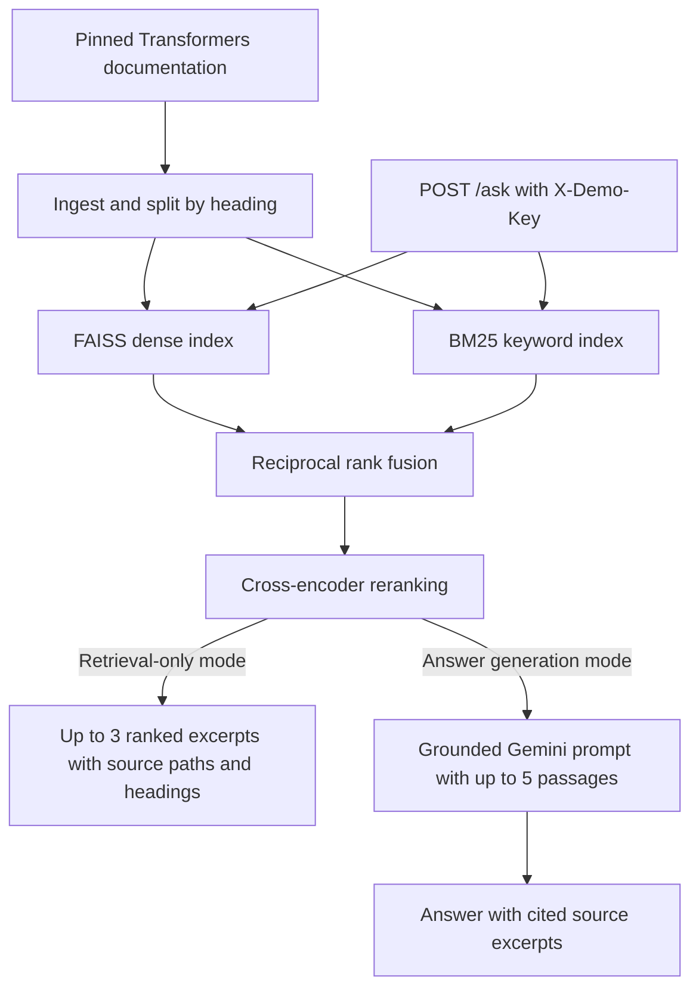
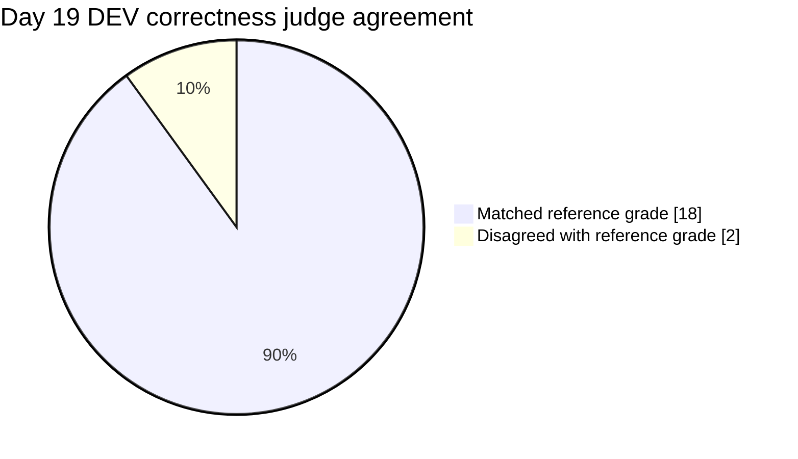

# hf-docs-qa

Transformers Docs QA helps developers find relevant passages in a pinned version
of the Hugging Face Transformers documentation. It combines dense search and
BM25, then reranks the results. The retrieval-only demo returns ranked excerpts
with their source paths and headings using zero LLM tokens.

## Demo

[Try the browser search demo](https://haroonpuzhakkal07-pixel.github.io/hf-docs-qa/).
It runs BM25 keyword search locally in your browser over selected excerpts from
seven pinned documentation pages. Results link to their source lines. The
Docker quickstart runs the full hybrid retrieval and reranking pipeline.

[Watch the 75-second retrieval-only demo](https://youtu.be/LHcCyyEmmag).

The demo shows a lookup and a two-step question against the pinned Transformers
documentation. Both live requests return ranked source excerpts with zero LLM
usage. The closing segment illustrates the expected refusal with an offline
example. The live retrieval-only API does not perform evidence-based refusal.

## Quickstart

Run these commands from the repository root in PowerShell with Docker running.
The build downloads the pinned Transformers documentation and retrieval models.

```powershell
docker build `
  --build-arg "DOCS_RAG_SOURCE_COMMIT=$(git rev-parse HEAD)" `
  --build-arg "DOCS_RAG_SOURCE_DIRTY=$(if (git status --porcelain) { '1' } else { '0' })" `
  -t hf-docs-qa:local .

docker run --rm --name hf-docs-qa-local -p 127.0.0.1:8005:8000 `
  -e DOCS_RAG_RETRIEVAL_ONLY=1 `
  -e "DOCS_RAG_DEMO_KEY=$([guid]::NewGuid().ToString('N'))" `
  hf-docs-qa:local
```

Leave the container running. Once Uvicorn reports that startup is complete,
check the API from a second PowerShell window.

```powershell
curl.exe --fail --silent --show-error http://127.0.0.1:8005/health
```

The expected response is `{"status":"ok"}`. The API schema is available at
`http://127.0.0.1:8005/docs`. Press Ctrl+C in the first window to stop the container.

## Current status

Implemented through Day 20:

- Reviewed and selected 740 documentation pages.
- Implemented conservative ingestion and two source-preserving chunking configurations.
- Generated and verified both chunk datasets and their provenance manifests.
- Built and verified normalized dense indexes for both configurations.
- Added a command-line search and inspected 15 shared queries per configuration.
- Reviewed retrieval failures and recorded hypotheses for Week 2 experiments.
- Completed 60 evaluation questions: 24 lookup, 12 multi-step, 12 new-or-changed and 12 unanswerable, with source-label validation and documented absence checks.
- Added reusable dev-only retrieval evaluation and saved both dense baseline runs with provenance.
- Built and verified BM25 indexes for both chunkers, evaluated both on answerable dev questions and compared their rankings with dense retrieval.
- Implemented hybrid reciprocal rank fusion and pinned cross-encoder reranking, with complete-input guards.
- Saved six matched retrieval runs on 36 answerable dev questions, including per-query latency and provenance.
- Added checked Gemini completions and persistent response caching.
- Added the grounded answer prompt and verified citations and refusals on six manual DEV questions.
- All 304 tests passed on Day 16.
- Saved closed-book and BM25 heading answers for the same 45 DEV questions and manually reviewed 10 responses.
- Added correctness and faithfulness judging. The 10-answer DEV trial produced valid JSON on the first attempt for all 5 correctness calls and both faithfulness calls.
- Validated Gemini 3.1 Flash-Lite as the default judge. Its correctness verdicts agreed with 18 of 20 assistant-assisted DEV reference grades (90%). A separate faithfulness spot check matched all 3 expected verdicts.
- Compared all six answer configurations on the same 45 DEV questions. The overall and per-question-type results are in [the Day 20 report](eval/results/summary.md).

Manual observations, failures and baseline results are recorded in NOTES.md.

## Architecture

- **Build the indexes.** During the Docker build, [`scripts/build_artifacts.py`](scripts/build_artifacts.py) fetches the pinned Transformers documentation and prefetches the pinned tokenizer, embedding model, and reranker. It ingests the selected pages, creates heading-aware passages, and builds a dense FAISS index and a BM25 index over those same passages.
- **Serve questions.** The [Dockerfile](Dockerfile) starts Uvicorn with `src.api:app`. At startup, the [FastAPI app](src/api.py) checks the heading indexes and loads the embedding model and reranker. `GET /health` returns `{"status":"ok"}` after startup.
- **Retrieve and answer.** `POST /ask` uses `hybrid_rerank_heading`. Dense and BM25 rankings are combined with reciprocal rank fusion, then a cross-encoder reranks the candidates. Up to five passages are sent to the grounded answer prompt. The Gemini completion layer supports a persistent response cache. The API returns the answer, cited source snippets, retrieval and completion timings, and token usage.



### Design choices

- **Heading-aware chunks** preserve section context and make excerpts traceable
  to their source headings.
- **Hybrid search** combines dense retrieval for paraphrased questions with
  BM25 for exact terms such as API names and parameter names.
- **Cross-encoder reranking** scores each candidate passage together with the
  question before selecting the excerpts shown by the API.

## Corpus

- Source: https://github.com/huggingface/transformers
- Commit: `469230357aab0f2b303b0d638c1f8d06edb14184`
- Documentation directory: `docs/source/en`
- Reviewed: 752 Markdown pages, including 531 model pages.
- Selected: 740 pages; excluded: 12. All 531 model pages were included.

Selection includes answer-bearing explanations, model facts, usage guidance, code examples and meaningful tables. Pages containing only navigation, file pointers or API scaffolding without useful source content are excluded. There are no page limits, folder exclusions or model quotas.

Selected paths are in [src/config.py](src/config.py). Per-page decisions, reasons and evidence are in [data/selection_report.csv](data/selection_report.csv).

Source previews were supplemented with further inspection where necessary, and every exclusion was manually reviewed. Inclusion does not certify source facts or example correctness.

## Setup

The commands below use PowerShell and Python 3.11.

### Python environment

From the repository root:

```powershell
py -3.11 -m venv .venv
.\.venv\Scripts\python.exe -m pip install -r requirements.txt
```

The current requirements file is an environment snapshot from `pip freeze`. Cross-platform installation has not yet been validated.

### Download the pinned corpus

For a new checkout where `data/raw/transformers` does not already exist:

```powershell
git clone --depth 1 --filter=blob:none --sparse https://github.com/huggingface/transformers data/raw/transformers
git -C data/raw/transformers sparse-checkout set docs/source/en
git -C data/raw/transformers fetch --depth 1 origin 469230357aab0f2b303b0d638c1f8d06edb14184
git -C data/raw/transformers checkout --detach 469230357aab0f2b303b0d638c1f8d06edb14184
```

Verify the commit and save the local version record:

```powershell
git -C data/raw/transformers rev-parse HEAD
git -C data/raw/transformers rev-parse HEAD |
    Set-Content -Encoding ascii data/CORPUS_VERSION.txt
```

The printed commit must match the pin above. Ingestion reads the local files; it does not fetch or enforce the Git pin automatically.

## Ingestion

Run from the repository root:

```powershell
.\.venv\Scripts\python.exe -B -m src.ingest
```

Creates `data/processed/docs.jsonl`, containing one record per selected page:

| Field | Meaning |
| --- | --- |
| doc_id | Stable identifier using the relative source path |
| path | Source path relative to docs/source/en |
| title | First H1 outside comments and fenced code, with five explicit fallbacks |
| text | Cleaned Markdown source |

The pinned selection produces **740 documents**.

Cleaning removes leading license comments and YAML front matter. Standalone tab wrappers become readable labels. Body content, including code, tables, links and technical caveats, is preserved.

The command refuses to overwrite an existing output file.

### Regenerate an existing dataset

Write and verify a candidate before replacing the existing output:

```powershell
@'
import json

from src.config import INCLUDE, REPO_ROOT
from src.ingest import load_documents, write_documents

output = REPO_ROOT / "data" / "processed" / "docs.jsonl"
candidate = output.with_name("docs.next.jsonl")

if candidate.exists():
    raise SystemExit("Candidate already exists; inspect it before continuing.")

count = write_documents(candidate)

with candidate.open(encoding="utf-8") as stream:
    saved = [json.loads(line) for line in stream]

if count != len(INCLUDE) or saved != load_documents():
    raise SystemExit("Verification failed; existing output was not replaced.")

candidate.replace(output)
print(f"Saved and verified {count} documents.")
'@ | .\.venv\Scripts\python.exe -B -
```

If verification fails, inspect the candidate before removing it or retrying.

## Fixed-size chunking

Chunking uses the tokenizer for `BAAI/bge-small-en-v1.5`, pinned to revision `5c38ec7c405ec4b44b94cc5a9bb96e735b38267a`.

Download the pinned tokenizer once:

```powershell
@'
from transformers import AutoTokenizer
from src.config import EMBEDDING_MODEL, EMBEDDING_REVISION

AutoTokenizer.from_pretrained(
    EMBEDDING_MODEL,
    revision=EMBEDDING_REVISION,
    use_fast=True,
)
print("Tokenizer cached.")
'@ | .\.venv\Scripts\python.exe -B -
```

Chunking subsequently loads the tokenizer from the local cache:

```powershell
.\.venv\Scripts\python.exe -B -m src.chunking
```

The input is `data/processed/docs.jsonl`. Outputs are:

- `data/processed/chunks_fixed.jsonl`
- `data/processed/chunks_fixed.manifest.json`

The command refuses to overwrite either output.

### Configuration and records

- Target window: 300 content tokens.
- Overlap: 50 content tokens.
- Safety limit: 400 tokens, including special tokens.
- Token counts are recalculated from each final passage.

Each record contains `chunk_id`, `doc_id`, `path`, `heading_path`, `text`, `token_count`, `start_char` and `end_char`.

Chunk text is an exact source substring. Character offsets are zero-based, with an exclusive end position. Overlapping chunks cover the complete document, including whitespace. `heading_path` is empty for this baseline.

Fixed-size boundaries can split words, code blocks and tables. Structural chunking is a separate comparison; this baseline preserves source coverage rather than section boundaries.

### Verified corpus output

| Metric | Value |
| --- | ---: |
| Documents | 740 |
| Chunks | 5,703 |
| Average tokens, including special tokens | 285.99 |
| Minimum tokens | 53 |
| Maximum tokens | 303 |

All saved chunks passed checks for source coverage, exact text, metadata and token limits.

The manifest records configuration, model revision, corpus commit, Git commit and dirty status, tokenizer package versions, input/output hashes, implementation hashes and aggregate statistics.

`git_dirty: true` means generation used uncommitted project changes. The recorded implementation hashes identify the source bytes used. These statistics describe chunk construction, not retrieval quality.

## Heading-aware chunking

Uses the same cached, pinned tokenizer as the fixed-size baseline.

Generate the dataset from the repository root:

```powershell
@'
import json

from src.chunking_heading import write_heading_dataset
from src.config import REPO_ROOT

manifest = write_heading_dataset(
    REPO_ROOT / "data" / "processed" / "docs.jsonl",
    REPO_ROOT / "data" / "processed" / "chunks_heading.jsonl",
)
print(json.dumps(manifest["statistics"], indent=2))
'@ | .\.venv\Scripts\python.exe -B -
```

Outputs:

- `data/processed/chunks_heading.jsonl`
- `data/processed/chunks_heading.manifest.json`

The writer refuses to overwrite either output.

### Behavior and records

- Split at H1–H3 headings outside fenced code and HTML comments.
- Pack content at blank-line boundaries, keeping fitting code blocks whole.
- Use a soft minimum of 80 tokens; merge eligible neighboring chunks when the combined passage fits.
- Target 30 content tokens of overlap within long sections where feasible.
- Enforce a maximum of 400 tokens, including heading prefixes, added formatting and special tokens.

Oversized code blocks must be split to respect the token limit. Prefer sufficiently filled line boundaries; split within an oversized line when necessary. Code fragments remain separate during small-chunk merging.

Records include the baseline metadata plus `heading_paths`, `source_text`, `code_fragment` and `fragment_fence`.

`source_text` is the exact document substring identified by `start_char:end_char`. `text` is the passage to embed: the heading prefix followed by source content. Multiple heading paths are retained when chunks merge.

Oversized code fragments additionally use an outer tilde fence labeled `markdown`, longer than any tilde run in the source block. This quotes the original Markdown fragment without modifying its source text. It does not make partial code executable.

### Verified corpus comparison

| Metric | Fixed | Heading |
| --- | ---: | ---: |
| Documents | 740 | 740 |
| Chunks | 5,703 | 5,771 |
| Average tokens, including special tokens | 285.99 | 263.00 |
| Minimum tokens | 53 | 15 |
| Maximum tokens | 303 | 400 |

The heading dataset contains 604 code fragments and 296 chunks below the soft minimum of 80 tokens. No saved chunk has whitespace-only source content.

Both datasets passed saved-file verification for hashes, metadata, exact source slices, complete character coverage and final token counts. Heading chunks also passed fence-boundary and fragment-format checks.

These configurations differ in size policy, overlap and heading context. Their construction statistics do not establish retrieval quality or isolate the effect of heading boundaries.

The heading manifest records configuration, policies, corpus and model pins, Git state, package versions, input/output hashes, implementation hashes and aggregate statistics.

## Dense indexing and search

### Cache the pinned model

Download the complete embedding model once. The tokenizer cache alone is
insufficient.

```powershell
@'
from sentence_transformers import SentenceTransformer
from src.config import EMBEDDING_MODEL, EMBEDDING_REVISION

SentenceTransformer(
    EMBEDDING_MODEL,
    revision=EMBEDDING_REVISION,
    device="cpu",
    trust_remote_code=False,
)
print("Pinned embedding model cached.")
'@ | .\.venv\Scripts\python.exe -B -
```

Subsequent indexing and search load the model from the local cache only.

### Build both indexes

After generating the chunk datasets and manifests:

```powershell
.\.venv\Scripts\python.exe -B -m src.index --chunker fixed --batch-size 64
.\.venv\Scripts\python.exe -B -m src.index --chunker heading --batch-size 64
```

Each command creates `data/index/<chunker>/` containing:

- `index.faiss`: exact inner-product search with `faiss.IndexFlatIP`.
- `chunks.jsonl`: a byte-identical copy of the input chunk dataset.
- `manifest.json`: model settings, corpus and Git state, package versions,
  input provenance, implementation hashes and artifact hashes.

FAISS row numbers correspond to zero-based chunk-record order. Complete saved
`text` passages are embedded, including heading context and fragment formatting.
The writer refuses any existing output directory, including an incomplete one;
inspect existing outputs before deciding how to preserve or replace them.

Encoding uses CPU float32 vectors with unit normalization. Batch size 64 is
adjustable. All complete inputs are checked against the loaded encoder's
sequence limit, including special tokens and any prompt. Overlong inputs raise
an error instead of being truncated.

The verified model limit is 512 tokens. Fixed passages contain 53–303 encoder
tokens; heading passages contain 15–400. Both datasets fit without truncation.

| Index | Rows | Dimensions |
| --- | ---: | ---: |
| Fixed | 5,703 | 384 |
| Heading | 5,771 | 384 |

Saved-file checks verified artifact hashes, exact mapping copies, finite
normalized vectors and sampled row associations by re-encoding passages.

### Search

```powershell
.\.venv\Scripts\python.exe -B -m src.retrieve --index heading --k 5 "How do I load a model in 8-bit using bitsandbytes?"
```

Use `--index fixed` for the baseline. Results display score, source path,
heading path, chunk ID and a 150-character preview. The Python function
`dense_search(query, index_name, k)` returns complete scored chunk records.

Queries explicitly receive the prefix
`"Represent this sentence for searching relevant passages: "` including its
trailing space. Passages receive no instruction. This follows the
[pinned model card](https://huggingface.co/BAAI/bge-small-en-v1.5/blob/5c38ec7c405ec4b44b94cc5a9bb96e735b38267a/README.md);
the loaded model's configured query prompt is empty.

Both query and passage vectors are normalized, so inner-product scores represent
cosine similarity, not probabilities. The loader checks artifact hashes and
embedding compatibility before search. Indexes and the model are cached within
each process; restart the process after replacing saved artifacts.

Fifteen shared exploratory queries were inspected for each configuration.
Detailed observations are in NOTES.md. These are not formal evaluation results,
and a retrieved page can still lack the required answering passage.

## Evaluation questions

`eval/questions.jsonl` contains 60 questions:

| Type | Count |
| --- | ---: |
| lookup | 24 |
| multi_step | 12 |
| new_or_changed | 12 |
| unanswerable | 12 |

The split contains 45 dev questions (36 answerable, 9 unanswerable) and
15 test questions (12 answerable, 3 unanswerable).

Each record includes a stable ID, question, type, answerability, gold answer,
source references and split. Unanswerable records have an empty gold answer
and no gold sources.

Current dataset SHA256:
`cb13412b789ac5b8eebd1c70873f7e908c5a83ff80a2452f16f387353e4d3733`.

The new_or_changed category covers recently contributed model pages identified
during corpus review. It does not establish when each feature was introduced
or whether a closed-book model can answer the question.

Unanswerable means the requested answer is unsupported by the pinned
documentation corpus. Searches and contextual absence checks across all
752 Markdown pages, including excluded pages, are recorded in
[eval/unanswerable_checks.md](eval/unanswerable_checks.md).
These labels do not establish that answers are unavailable externally.

Source paths are relative to `docs/source/en`. Source headings use the full
H1–H3 hierarchy, matching the structural scanner. For content under deeper
headings, reference the enclosing H1–H3 section.

Validate the dataset from the repository root:

```powershell
.\.venv\Scripts\python.exe -B -m eval.check_questions
```

The checker verifies the downloaded corpus commit, record structure,
sequential IDs, duplicate questions, type/answerability consistency,
split assignments, selected source-file existence and heading references
outside code and comments. Semantic support and absence require manual review.

Multi-step records must cite at least two distinct path-and-heading references.
Manual review must also establish that answering the question requires
combining the cited evidence; two references alone do not prove this.

Every fourth question in authoring order is assigned to test, from q004
through q060. Preserve IDs and order when extending the dataset.
Source-label validation is allowed for test questions; retrieval and generation
performance must not be inspected during development.

The Day 6 manual queries remain development examples. Day 11–12 retrieval
results use the original 35 answerable dev questions; Day 13 results use
36 answerable dev questions from the expanded dataset. Answer-quality and
abstention evaluation are upcoming.

## BM25 indexing and search

BM25 uses `rank_bm25.BM25Okapi` with k1=1.5, b=0.75 and epsilon=0.25.
Tokenization lowercases text and extracts `[a-z0-9_]+`, retaining underscores
and repeated terms. There is no stemming or stopword removal.

Build both indexes from the existing complete chunk datasets:

```powershell
.\.venv\Scripts\python.exe -B -m src.bm25 build --index fixed
.\.venv\Scripts\python.exe -B -m src.bm25 build --index heading
```

Outputs are separate from the dense indexes, under
`data/index/bm25/<chunker>/`: a byte-identical `chunks.jsonl`, token lists
in `tokens.pkl`, and a provenance `manifest.json`. The writer refuses any
existing output directory, including an incomplete one.

Both saved mappings match their dense counterparts: 5,703 fixed rows and
5,771 heading rows. Token lists preserve row order and do not modify source
text. Hashes, configuration and token-to-text alignment are checked on load.
Pickle artifacts are intended to be locally generated.

Search a saved index:

```powershell
.\.venv\Scripts\python.exe -B -m src.bm25 search --index heading --k 5 "How do I choose a cosine learning-rate scheduler?"
```

Search returns complete scored chunk records. Candidates must share at least
one query token; a query with no matches returns no results. Equal scores are
ordered by saved row number. Loaded indexes are cached per process; restart
after replacing artifacts. Compare retrieval methods using evaluation
metrics rather than their raw score scales.

## Hybrid retrieval and reranking

`hybrid_search(query, index_name, k=5)` combines up to 50 dense and 50
BM25 candidates using reciprocal rank fusion:

`score(chunk) = sum(1 / (60 + rank))`

Ranks are one-based. Matching chunk IDs are merged, and equal fused scores
use ascending chunk_id. Both indexes must have identical complete chunk
mappings. Returned records preserve full source content and contributing
ranks in rrf_ranks.

`reranked_search(query, index_name, k=5)` scores the top 20 hybrid candidates
with `cross-encoder/ms-marco-MiniLM-L6-v2`, pinned to revision
`233902d25c440f23af6f7d6e94d2946bac0bee0a`.
It uses CPU float32 and Identity activation, returning raw relevance scores.
Equal scores retain hybrid order. hybrid_score, hybrid_rank and rrf_ranks
preserve the preceding ranking information.

Complete query-passage pairs, including special tokens, must fit within
512 tokens. All pairs are checked before inference. Oversized pairs fail
without silently truncating source content. The default output is five
chunks; requesting ten supports retrieval evaluation.

### Cache the pinned reranker

Run once before reranked retrieval:

```powershell
@'
import torch
from sentence_transformers import CrossEncoder
from src.config import (
    RERANKER_MODEL,
    RERANKER_REVISION,
    RERANKER_MAX_LENGTH,
)

model = CrossEncoder(
    RERANKER_MODEL,
    revision=RERANKER_REVISION,
    device="cpu",
    trust_remote_code=False,
    max_length=RERANKER_MAX_LENGTH,
    model_kwargs={"dtype": torch.float32},
    activation_fn=torch.nn.Identity(),
)
assert model.max_seq_length == RERANKER_MAX_LENGTH
assert model.config.max_position_embeddings == RERANKER_MAX_LENGTH
assert model.num_labels == 1
assert next(model.parameters()).dtype == torch.float32
print("Pinned reranker cached.")
'@ | .\.venv\Scripts\python.exe -B -
```

Runtime retrieval loads the pinned models from the local cache.

## Retrieval evaluation

Run from the repository root after building the corresponding indexes and
caching the required models:

```powershell
.\.venv\Scripts\python.exe -B -m src.evaluate --retriever dense --index fixed --run-name day13
.\.venv\Scripts\python.exe -B -m src.evaluate --retriever dense --index heading --run-name day13
.\.venv\Scripts\python.exe -B -m src.evaluate --retriever bm25 --index fixed --run-name day13
.\.venv\Scripts\python.exe -B -m src.evaluate --retriever bm25 --index heading --run-name day13
.\.venv\Scripts\python.exe -B -m src.evaluate --retriever hybrid --index heading --run-name day13
.\.venv\Scripts\python.exe -B -m src.evaluate --retriever reranked --index heading --run-name day13
```

These results already exist, so repeating these commands refuses to overwrite
them. Use a new run name for a deliberate new experiment.
Named runs are saved under `eval/results/retrieval/<run-name>/`, with filenames
`<retriever>_<chunker>_dev.json`. Run names contain letters, digits, underscores
or hyphens and start with a letter or digit.

Without --run-name, results use the original retrieval results directory.
Omitting --retriever selects dense retrieval. Historical Day 11–12 files
remain preserved and are documented in NOTES.md.

The reusable `eval_retrieval(retriever, questions, ks=(1, 3, 5, 10))` function
accepts a callable with the interface `retriever(query, k=...)`. Questions must
first pass dataset validation. It filters to answerable dev questions before
retrieval and requests the maximum k once per question.

A hit means a retrieved chunk's source path matches any gold source page.
Following the project plan, recall@k is the fraction of evaluated questions
with at least one hit within the first k chunk ranks. Repeated pages retain
their chunk ranks; results are not collapsed by page.

MRR@10 averages the reciprocal rank of the first hit within 10 chunks,
with zero for a miss. Both denominators include all 36 evaluated questions.
A page hit does not establish complete answering evidence or coverage of
every source required by a multi-step question.

### Day 13 matched dev results

All six configurations use the same expanded dataset and 36 answerable dev
questions. Recall entries show questions with a hit / 36.

| Configuration | recall@1 | recall@3 | recall@5 | recall@10 | MRR@10 |
| --- | ---: | ---: | ---: | ---: | ---: |
| Dense + fixed | 26/36 | 31/36 | 32/36 | 32/36 | 0.7926 |
| Dense + heading | 26/36 | 33/36 | 34/36 | 35/36 | 0.8218 |
| BM25 + fixed | 28/36 | 32/36 | 34/36 | 35/36 | 0.8359 |
| BM25 + heading | 27/36 | 35/36 | 35/36 | 35/36 | 0.8380 |
| Hybrid + heading | 30/36 | 35/36 | 35/36 | 35/36 | 0.8981 |
| Reranked hybrid + heading | 33/36 | 34/36 | 35/36 | 35/36 | 0.9329 |

Reranking improves rank-1 hits and MRR@10, while recall@3 falls from 35/36
to 34/36. Mean query latency is 65.72 ms for hybrid heading and 1053.27 ms
for reranked hybrid heading. NOTES.md records latency for all six runs and
per-question ranking changes.

Per-question elapsed_ms covers the retriever call and result materialization,
including input-length checks. Models and indexes are loaded before timing;
no inference warmup is performed. Metric calculation, provenance and result
serialization are excluded. These are local CPU observations from one run,
not repeated latency benchmarks.

These are small development-set comparisons. Dense and BM25 use identical
chunk mappings within each chunker. Comparisons between chunkers also differ
in size policy, overlap and heading context, so differences cannot be
attributed solely to heading boundaries. Earlier 35-question results use a
different denominator. All 15 held-out test questions remain unevaluated.

Each saved run includes configuration, metric definitions, dataset SHA256,
corpus commit and cleanliness, index manifests and actual artifact hashes,
implementation hashes, package versions, Python/platform details,
Git commit and dirty status, and complete per-question retrieved records.
Hybrid and reranked runs record both indexes; reranked runs also record
the pinned cross-encoder settings.

The runners reject provenance changes during evaluation and preserve
existing source files, indexes and result files.

## Day 14 retrieval selection

Carry **BM25 + heading**, with five retrieved chunks, into Week 3.

The matched Day 13 runs give BM25 heading, hybrid heading and reranked
heading the highest recall@5: 35/36 answerable DEV questions (97.22%).
BM25 heading is fastest among those three: mean 40.58 ms/query, compared
with 65.72 ms for hybrid and 1053.27 ms for reranked retrieval.
Dense heading is faster at 24.96 ms but scores 34/36 at recall@5,
2.78 percentage points below the maximum, outside the plan's two-point
allowance. Selection follows the plan's recall@5 and speed rule.

Hybrid and reranked retrieval retain advantages at rank 1 and MRR@10.
This selection is based on retrieval metrics. Timings are single-run
local CPU observations.

Reviewed the selected configuration's only miss@5, q026, also a miss@10.
Both gold facts survive completely in the indexed passages, and the gold
label remains valid. The closest failure category is vocabulary mismatch:
retrieved passages match parts of the query without the required
model-specific evidence. The precise scoring cause was not measured.
See [the retrieval miss analysis](eval/retrieval_analysis.md).
Only one miss exists, so the plan's requested ten-miss review was reduced
to that one actual case.

No dataset labels, retrieval settings, indexes or historical results were
changed. Held-out TEST performance remains untouched.

## LLM access and completion cache

`src/llm.py` provides:

```python
from src.llm import complete

result = complete(
    system="Follow the requested output format. Return only the requested text.",
    prompt="Return exactly: DAY15_OK",
    temperature=0,
    max_tokens=500,
)
print(result["text"])
```

Uses Gemini Developer API model `gemini-3.5-flash-lite` with explicit
MINIMAL thinking. The existing httpx and python-dotenv dependencies are
sufficient; no additional packages were installed.

### Credentials

For a new checkout, copy `.env.example` to `.env` only if `.env` does not
already exist. Replace its placeholder with your Gemini API key locally.
The adapter reads GEMINI_API_KEY specifically from the repository `.env`,
rather than selecting a key from shell environment variables.

Keep `.env` private and ignored by Git. `.env.example` contains only a
placeholder. For the zero-budget setup, use a key belonging to a project
verified as Free tier and leave billing unlinked.

### Input and response handling

The adapter sends the complete system instruction and prompt to
countTokens before generation. Inputs exceeding 1,048,576 tokens are
rejected without generation or truncation. max_tokens must be between
1 and the model's 65,536-token output limit; its default is 500.

Pass `input_token_budget` to set a lower limit for the complete input.
Fresh requests use Gemini's `countTokens` result, and cache hits use the
saved preflight count. Requests above the budget raise an error without
truncating the input.

Only a nonempty text response with finishReason STOP and valid usage
metadata is accepted. Responses stopped by the output limit or other
abnormal finish reasons are rejected. Each HTTP request has a 60-second
timeout and no automatic retries. HTTP error messages omit credentials
and server response bodies.

### Persistent cache and returned fields

Successful completions are saved under `data/cache/llm/`, covered by the
existing data ignore rule. The SHA256 key includes complete prompts,
model ID, generation settings, endpoint, token limits, cache schema and
implementation-file hash. Credentials are excluded.

Entries preserve complete request text, response text, reported model
version, usage and original timings. Changed requests or implementation
bytes create separate entries without replacing historical ones.
Malformed or incompatible entries raise an error without HTTP fallback.
Failed completions are not cached. Writes refuse existing cache files;
concurrent cache misses are not coordinated.

A cache hit requires neither credentials nor HTTP access.

| Field | Meaning |
| --- | --- |
| text | Complete answer text |
| model, model_version | Requested model and provider-reported version |
| tokens_in, tokens_out, thinking_tokens, total_tokens | Original generation usage, retained on cache hits |
| preflight_tokens | Original complete-input token count |
| api_usage | Generation usage for this call; all zero on cache hits; excludes the separate token-counting request |
| cache_hit, cache_key | Reuse status and cache-entry identifier |
| latency_ms | Current call duration, including cache access or writing |
| generation_ms | Generation-request duration; zero on cache hits |
| original_latency_ms, original_generation_ms | Original uncached adapter and generation-request durations |
| finish_reason | STOP for accepted responses |

Temperature zero does not guarantee identical fresh API responses.
Cache reuse preserves a saved response. The live API reported
model_version as the model alias, not an immutable dated revision;
fresh calls may therefore use a changed serving model.

### Verification

A synthetic live call returned DAY15_OK with 21 input tokens, 5 output
tokens and no thinking tokens. A separate cached run took approximately
1,461 ms on its miss and 13 ms on a hit in a new Python process.
The second process blocked HTTP client creation and credential loading,
returned the same answer and cache key, and reported zero API usage.
These are smoke observations, not latency benchmarks.

On Day 15, no evaluation questions were sent to the LLM. Retrieval settings,
datasets, indexes and historical results remain unchanged.

## Grounded answer prompt

`src/prompting.py` formats up to five chunks in retrieval order, with a
passage number, source path, heading and complete text. The system prompt
asks for concise answers supported by those passages, citations such as
`[1]`, and the exact refusal `I can't find this in the documentation.`
when the evidence is insufficient.

Day 16 used BM25 with the heading index and `k=5`. The 3,000-token budget
covers the whole request, including the system instruction, question,
passage labels and text. Gemini counted 1,062 to 1,696 input tokens across
the six manual DEV checks. All four answerable responses cited supporting
passages, and both unanswerable responses returned the exact refusal.
See NOTES.md for the individual observations.

## DEV answer generation

`answer(question, config)` supports `closed_book`, `dense_fixed`,
`dense_heading`, `bm25_heading`, `hybrid_heading`, and
`hybrid_rerank_heading`. Closed-book sends the question alone. Each
grounded configuration supplies up to five complete passages in ranked
order. Citation numbers map to those passages and are returned as chunk
IDs in first-citation order. All configurations use the same Gemini
generator, temperature 0, a 500-token output cap, and a 3,000-token
complete-input budget.

From the repository root, run each configuration separately.

```powershell
.\.venv\Scripts\python.exe -B -m eval.run_answers closed_book
.\.venv\Scripts\python.exe -B -m eval.run_answers bm25_heading
```

The runner validates the dataset and selects the same 45 DEV questions
for each configuration, including 36 answerable and 9 unanswerable
questions. It writes one JSONL file per configuration under
`eval/results/answers/` after all selected answers succeed. Existing
result files are protected from overwrites.

Each row includes the answer, retrieved and cited chunk IDs, retrieval
and LLM timing in milliseconds, the preflight token count, original
response token usage and current-call API response token usage. Cache hits
retain original response usage and report zero current API usage.

## Day 20 DEV comparison

Each configuration ran on the same 45 DEV questions: 36 answerable and 9
unanswerable. Grounded configurations used up to five retrieved passages.

| Configuration | Page recall@5 | Correctness | Faithfulness | Correct refusals | Over-refusals |
| --- | ---: | ---: | ---: | ---: | ---: |
| Closed-book | N/A | 28/36 | N/A | 9/9 | 3/36 |
| Dense, fixed chunks | 32/36 | 24/36 | 24/24 | 9/9 | 12/36 |
| Dense, heading-aware chunks | 34/36 | 27/36 | 27/27 | 9/9 | 9/36 |
| BM25, heading-aware chunks | 35/36 | 30/36 | 30/30 | 9/9 | 6/36 |
| Hybrid, heading-aware chunks | 35/36 | 30/36 | 30/30 | 9/9 | 6/36 |
| Hybrid with reranking, heading-aware chunks | 35/36 | 29/36 | 29/29 | 9/9 | 7/36 |

Page recall@5 counts answerable questions with at least one gold source page in
the top five. Correctness covers all answerable questions, including refusals.
Faithfulness covers grounded responses that answered. Correct refusals and
over-refusals count exact refusals on unanswerable and answerable questions,
respectively.

See the [full DEV report](eval/results/summary.md) and
[summary CSV](eval/results/summary.csv) for per-type results, timing, and cost.

### Key findings

- The heading-aware dense configuration reached 34/36 on page recall@5 and
  27/36 on correctness. The fixed-chunk dense configuration reached 32/36
  and 24/36, respectively.
- BM25 and hybrid tied for the highest correctness at 30/36. The reranked
  hybrid configuration scored 29/36. All three had 35/36 page recall@5.
- Hybrid retrieved at least one gold source page for 8/9 multi-step questions
  and answered 3/9 correctly. Page recall measures whether retrieval found
  at least one relevant page. Multi-step answers can require several pieces
  of evidence.
- All six configurations correctly refused 9/9 unanswerable questions.
  The five grounded configurations also refused between 6 and 12 of the
  36 answerable questions.

### Judge agreement on DEV

Gemini 3.1 Flash-Lite matched 18 of 20 assistant-assisted correctness
reference grades (90%) in the Day 19 DEV validation sample. It matched all
16 positive grades and 2 of 4 negative grades. Both disagreements were
false positives against the reference grades.



### DEV error analysis

The Day 22 review covered all six incorrect answers from the heading-aware
hybrid configuration. All six were refusals on answerable multi-step questions.

| Cause | Count | What the review found |
| --- | ---: | --- |
| Retrieval miss | 5/6 | The top five passages lacked evidence for at least one part of the answer. |
| Wrong refusal | 1/6 | The retrieved passages supported a qualified answer. |

See the [Day 22 DEV error analysis](eval/error_analysis.csv) for the
per-question evidence.

### DEV retrieval depth experiment

Day 23 compared the top five and top eight passages from the same heading-aware
hybrid rankings for 36 answerable DEV questions.

| Gold source coverage | Top 5 | Top 8 |
| --- | ---: | ---: |
| At least one gold page, all answerable questions | 35/36 | 35/36 |
| At least one gold page, multi-step questions | 8/9 | 8/9 |
| All gold pages, all answerable questions | 32/36 | 34/36 |
| All gold pages, multi-step questions | 5/9 | 7/9 |

Manual review found that the extra passages supplied missing evidence in 3 of
the 5 retrieval misses identified on Day 22. The experiment measured source
coverage. The answer-generation path uses up to five passages.

See the [Day 23 DEV experiment notes](NOTES.md#day-23-dev-retrieval-depth-experiment).

## Tests

Run the synthetic pipeline and API checks from the repository root after setting up the Python 3.11 environment and caching the pinned tokenizer as described under [Fixed-size chunking](#fixed-size-chunking).

```powershell
.\.venv\Scripts\python.exe -B -m pytest -q -p no:cacheprovider tests/test_fixture_pipeline.py tests/test_api.py
```

These tests exercise heading-aware chunking, BM25 retrieval over fixture documents, and the `/ask` response with stubbed retrieval and completion. They require no Gemini credentials or generated indexes.

### CI and the DEV retrieval gate

The [CI workflow](.github/workflows/ci.yml) runs the full pytest suite after fetching the pinned corpus and prefetching the models. It then builds both heading indexes and runs a dense retrieval smoke check on 36 answerable DEV questions.

To run only the retrieval gate locally, use the existing pinned heading FAISS index and cached embedding model:

```powershell
.\.venv\Scripts\python.exe -B -m eval.ci_retrieval --baseline eval/baseline.json
```

The gate counts a question as a hit when at least one of the first five retrieved passages comes from a gold source page. The baseline is 34/36, and CI fails if recall@5 drops by more than 3 percentage points. The command prints the result and uses no generation or judging.

## Repository layout

```text
src/
  config.py                                     Corpus pin and selected paths
  ingest.py                                     Loading, cleaning and JSONL writing
  chunking.py                                   Fixed-size chunking and provenance
  chunking_heading.py                           Heading-aware chunking and provenance
  markdown_structure.py                         Source-preserving heading and fence scanning
  embeddings.py                                 Pinned model and checked normalized encoding
  index.py                                      Dense index writing and provenance
  retrieve.py                                   Verified index loading and search CLI
  evaluate.py                                   Retrieval metrics, provenance and evaluation CLI
  bm25.py                                       BM25 indexing, verified loading and search CLI
  hybrid.py                                    Reciprocal rank fusion and verified hybrid search
  rerank.py                                    Pinned cross-encoder scoring and reranked search
  llm.py                                       Checked Gemini completions and persistent response cache
  prompting.py                                 Grounded answer prompt and complete-passage formatting

tests/
  test_ingest.py                                Ingestion tests
  test_chunking.py                              Chunking and writer tests
  test_chunking_heading.py                      Heading chunking and writer tests
  test_markdown_structure.py                    Heading, fence and block-boundary tests
  test_index.py                                 Embedding guards, index and retrieval tests
  test_questions.py                             Evaluation-data validation tests
  test_evaluate.py                              Retrieval metric, writer and runner tests
  test_bm25.py                                  BM25 tokenization, indexing and retrieval tests
  test_hybrid.py                               Fusion and hybrid retrieval tests
  test_rerank.py                               Complete-pair scoring and reranking tests
  test_llm.py                                  Mocked completion, token-limit and disk-cache tests

eval/
  questions.jsonl                               Source-checked evaluation questions and labels
  check_questions.py                            Dataset and source-reference validation
  results/retrieval/                            Tracked dense and BM25 dev baseline results
  unanswerable_checks.md                       Pinned-corpus absence review
  results/retrieval/day13/                      Six matched dev runs with per-query timing

data/
  selection_report.csv                          Tracked selection decisions and evidence
  CORPUS_VERSION.txt                            Local corpus version record
  raw/transformers/                             Downloaded source checkout
  processed/docs.jsonl                          Generated documents
  processed/chunks_fixed.jsonl                  Generated chunks
  processed/chunks_fixed.manifest.json          Generation provenance
  processed/chunks_heading.jsonl                Generated heading chunks
  processed/chunks_heading.manifest.json        Heading generation provenance
  index/fixed/                                  Fixed index, chunk mapping and manifest
  index/heading/                                Heading index, chunk mapping and manifest
  index/bm25/fixed/                             Fixed BM25 tokens, chunk mapping and manifest
  index/bm25/heading/                           Heading BM25 tokens, chunk mapping and manifest
  cache/llm/                                   Ignored completion requests, responses and original usage
.env.example                Tracked API-key placeholder; copy to private .env
README.md                   Setup, usage and limitations
NOTES.md                    Decisions, failures and daily progress
```

Downloaded sources, processed corpus data, indexes, the virtual environment
and temporary files are ignored by Git. The selection report and retrieval
evaluation results are tracked.

## What didn't work

- The fixed-chunk dense configuration refused 8 of 9 answerable multi-step
  questions in the Day 20 DEV comparison.
- Hybrid with reranking answered 17/18 DEV lookup questions correctly, compared
  with 18/18 for hybrid. Both retrieved a gold page for all 18 lookup questions.
- In the Day 19 DEV judge validation, the judge accepted an incomplete answer
  that named TF32 but omitted the change to the mantissa.

## Limitations

- Remaining HTML, comments and doc-builder markup are retained.
- Autodoc directives are not expanded into API descriptions. Detailed API questions may lack sufficient source evidence.
- Source examples and inconsistencies are preserved; ingestion does not validate or repair them.
- Cleaning has preservation checks, but its effect on retrieval quality has not yet been measured.
- The evaluation uses one pinned revision of the Transformers documentation and
  a curated question set. Performance on questions from real users is unmeasured.
- The DEV multi-step slice has nine questions. One answer changes its
  correctness rate by about 11 percentage points.
- Correctness and faithfulness scores depend on an LLM judge, so errors in its
  verdicts can affect the reported scores.
- Structural scanning handles the observed corpus patterns but is not a complete Markdown parser. Oversized code is represented as source fragments.
- Dense search can confuse related models or retrieve the right page without the required answering passage. Manual observations do not establish general retrieval quality.

See [NOTES.md](NOTES.md) for decisions, source observations and evaluation candidates.

[](https://github.com/haroonpuzhakkal07-pixel/hf-docs-qa/actions/workflows/ci.yml?query=branch%3Amain)
